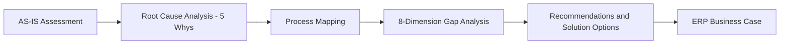
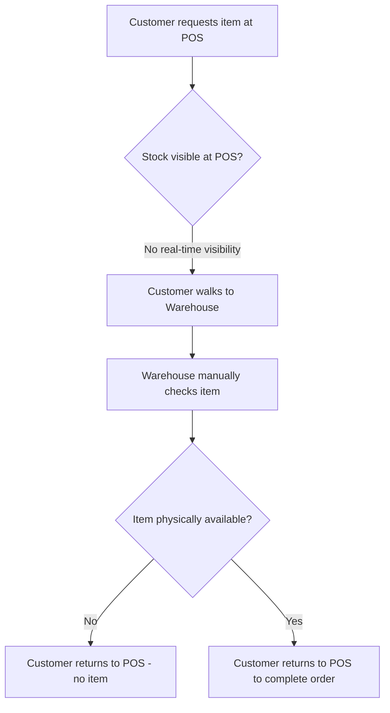
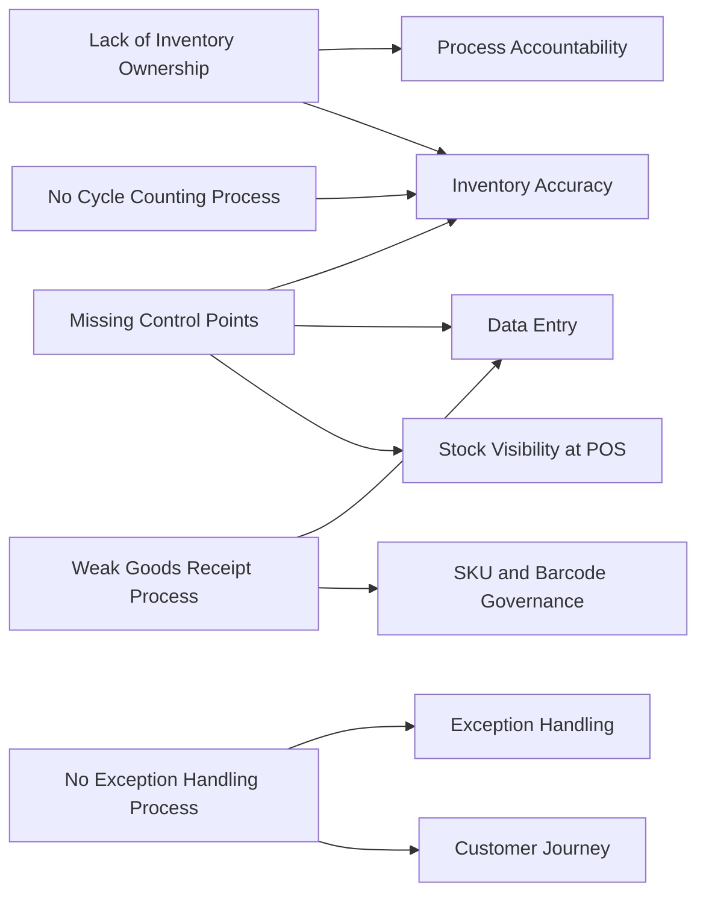
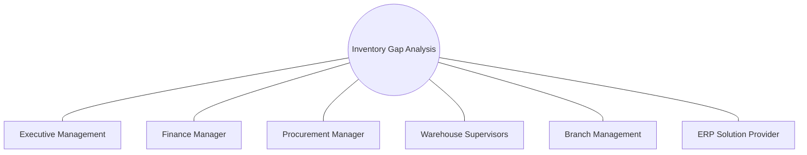

# Inventory Gap Analysis & ERP Readiness

**Case study** · FMCG retailer and wholesaler, Saudi Arabia · Nov 2019 – Apr 2020 · Role: ERP Business Analyst

This is the full write-up behind the [README](../README.md). It covers how I ran the analysis, what each of the 8 dimensions showed, how the findings came down to 5 root causes, and what I recommended.

## The business

The company ran 7 branches in the food, beverage, and consumer goods sector: 3 wholesale branches, 2 supermarkets, and 2 mini-markets. It managed more than 10,000 active SKUs, with a mix of perishable and non-perishable stock. The gap between system stock and physical stock was a known problem, but it had never been measured, and nobody had a structured view of its causes. Before any ERP investment, management needed to know how accurate the inventory records really were, and why.

## How I worked

I carried out the analysis myself, in four steps.

**AS-IS assessment.** I documented how inventory and related workflows actually ran in each branch. That became the baseline for measuring gaps.

**Data validation.** I pulled stock movement and inventory data from the reports of the existing system and used Excel for variance analysis and data validation.

**Process mapping.** I mapped the workflows to find the points where physical work and system records parted ways.

**Root cause analysis.** I used 5 Whys on each pattern of discrepancy, so the analysis would reach the causes and not stop at individual errors.

## What the 8 dimensions showed

**1. Inventory accuracy.** System stock and physical stock differed by 25–35% across the 7 branches. Unreliable stock figures affected order fulfillment, financial reporting, and purchasing. I recommended mandatory system control points at stock issue and a cycle counting process to replace annual-only counts.

**2. Stock visibility at POS.** Staff at the point of sale could not see warehouse stock before committing an order, so orders were often drafted against stock that was not physically there. I recommended a real-time stock query between POS and the warehouse before an order is confirmed.

**3. Data entry.** Data was entered by hand at POS, stock issue, inter-branch transfers, shipping and delivery, and goods receipt, where PO matching was not enforced. That meant frequent errors, slow processing, and inconsistent figures feeding the same inventory numbers. I recommended barcode or PDA scanning at the key touchpoints, ERP-enforced entry, and mandatory PO matching at receipt.

**4. Process accountability.** No one at branch level was formally responsible for inventory discrepancies, so nothing drove corrective action. I recommended a defined inventory owner for each branch.

**5. Customer journey.** In the wholesale branches I observed a 3-step physical loop: the customer went from POS to the warehouse and back to POS. It came directly from the lack of stock visibility, slowed every transaction, and put sales at risk. I recommended digital order confirmation to remove the trip back to POS.

**6. Exception handling.** There was no documented process for an unavailable item, so the same situation was handled differently depending on who dealt with it. I recommended a documented exception procedure with escalation and backorder or substitute options.

**7. SKU and barcode governance.** Two problems existed together. The same product was registered as separate SKUs when it came from different suppliers, and some barcodes were duplicated or missing because barcode use had never become a standard. Duplicate SKUs caused miscounts and confusion at picking, and the barcode gaps caused wrong picks and blocked scan-based control at receiving and issue. I recommended treating supplier origin as an attribute of a single SKU, and a barcode standard that requires a barcode on every product.

**8. Purchasing.** Purchasing was based on experience and estimates, with no inventory, demand, or consumption data behind it. The result was overstock on some items and stockouts on others. I recommended reorder points fed by live inventory and consumption data.

| Dimension | AS-IS gap | Recommended direction |
|---|---|---|
| Inventory accuracy | 25–35% variance | Mandatory control points, cycle counting |
| Stock visibility at POS | No real-time visibility before ordering | Real-time stock query at POS |
| Data entry | Manual at POS, issue, transfers, shipping, receipt | Barcode/PDA scanning, enforced entry |
| Process accountability | No owner per branch | Formal ownership per branch |
| Customer journey | 3-step physical loop (wholesale) | Digital order confirmation |
| Exception handling | No escalation process | Documented exception procedure |
| SKU and barcode governance | Duplicate SKUs, duplicate or missing barcodes | SKU normalization, barcode standard |
| Purchasing | Estimates, no data | Data-driven reorder points |

This is a direction-of-travel comparison. No post-implementation figures exist for a diagnostic project.

The wholesale customer journey looked like this:

## From 8 gaps to 5 root causes

The 8 dimensions came down to 5 causes, each affecting more than one area:

1. **Lack of inventory ownership**, behind process accountability and the persistence of the accuracy gap.
2. **Missing control points**, behind inventory accuracy, data entry, and stock visibility at POS.
3. **No cycle counting process**, behind inventory accuracy.
4. **No exception handling process**, behind exception handling and the customer journey problem.
5. **Weak goods receipt process**, behind data entry and SKU and barcode governance.

Because the 5 causes explained the gaps across all 8 dimensions, the business case asked management to fix 5 causes, not 8 separate symptoms.

## Recommendations and the business case

The measured variance, the mapped process breakdowns, and the 5 root causes went into a formal ERP business case, so the investment decision rested on measured findings. The main recommendations were an inventory owner for each branch, mandatory control points at issue, a cycle counting process, and a documented exception procedure.

For goods receipt I compared three options: PDA or mobile barcode scanning at receiving, ERP-based goods receipt with mandatory PO matching, and other receiving controls, to find the most practical path. Management had real choices to weigh, not only a list of problems.

## Stakeholders

I worked with and presented the findings to executive management, the finance manager, the procurement manager, warehouse supervisors, branch management, and the ERP solution provider.

## Outcome

The business case supported the decision to go ahead with an ERP, and the 8-dimension analysis became a direct input to part 2, the [Multi-Branch ERP Implementation](https://github.com/omaralburiki/Multi-Branch-ERP-Implementation).
